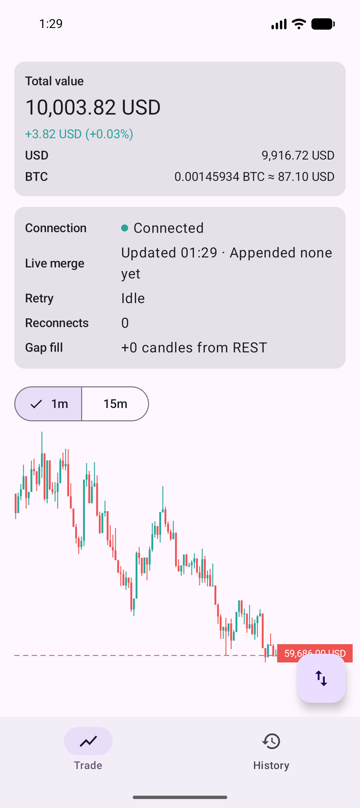
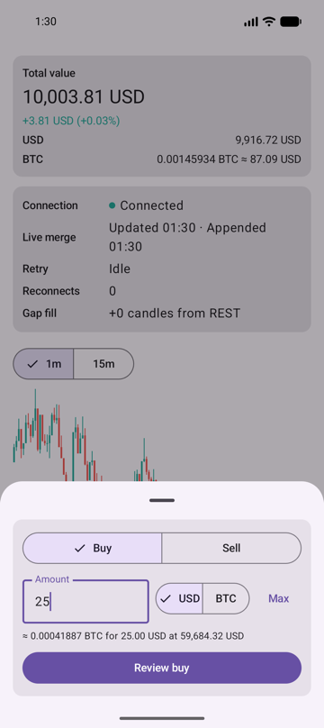
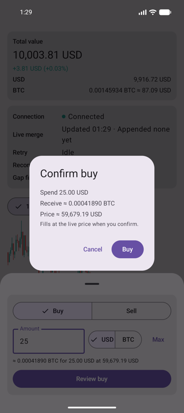
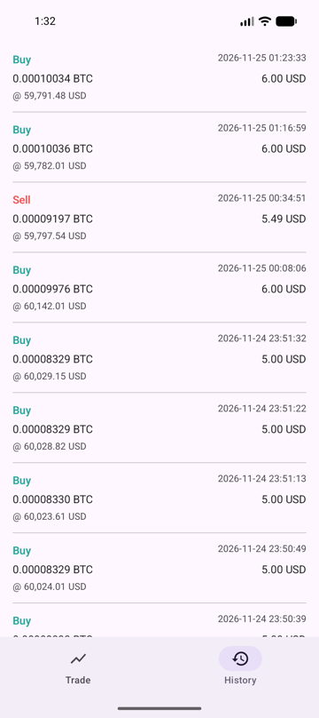
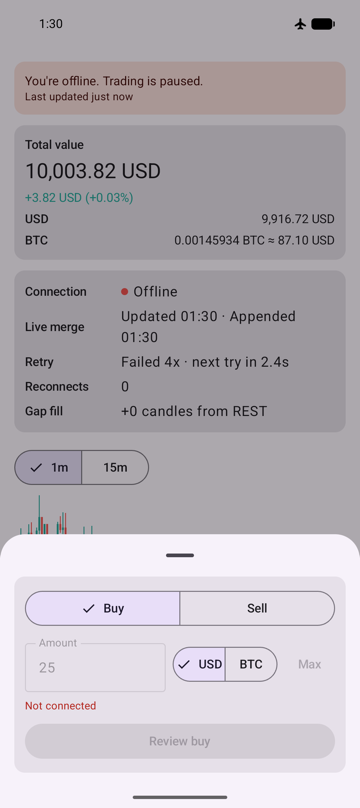
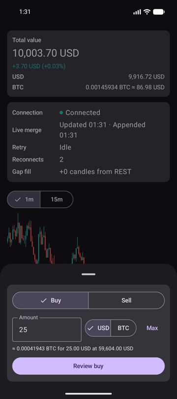
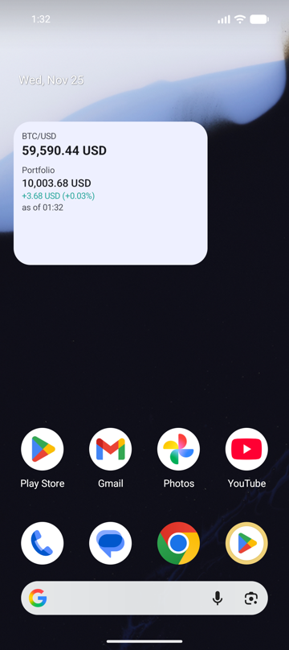
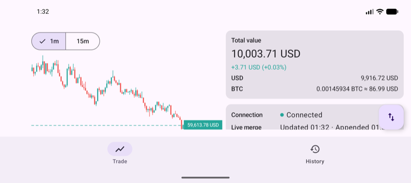
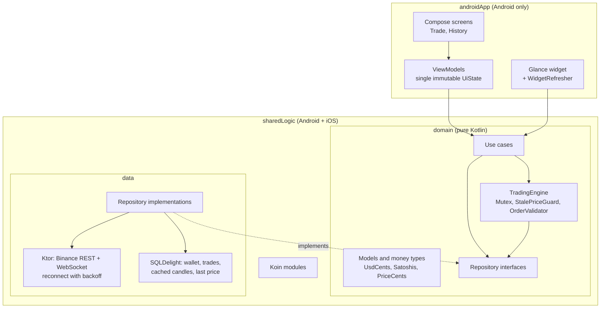

# TraderLens

Paper trading simulator for the BTC/USD spot market. Live market data comes from the public Binance API (REST for historical candles, WebSocket for live prices). All trading is simulated locally and works offline. Every user starts with 10,000 USD and 0 BTC.

Built with Kotlin Multiplatform: all business logic lives in a shared module that targets Android and iOS, and the Android app uses Jetpack Compose with Material 3.

## Screenshots

| Trade | Trade sheet | Confirm |
|:---:|:---:|:---:|
|  |  |  |
| **History** | **Offline** | **Dark mode** |
|  |  |  |
| **Home screen widget** | | |
|  | | |

**Wide layout** (landscape, tablets and foldables at 600dp and wider):

## Features

* Live candlestick chart drawn with Compose Canvas (no chart library), with an animated last candle, price line and up/down flash
* 1m and 15m intervals
* Market buy and sell in USD or BTC, with Max, live preview, confirmation dialog and validation
* Portfolio card with live total value and profit or loss
* Trade history (ledger)
* Offline banner with "Last updated" time; trading is disabled while the price is not live
* Offline launch from cached candles
* Home screen widget (Glance) with BTC price and portfolio value
* Dark mode, scrollable portrait layout and a two pane layout for wide screens

## Build and run

Requirements:

* Android Studio (recent stable) or the command line
* JDK 17 or newer
* Android SDK with API 37 installed
* For iOS tests: macOS with Xcode

| Task | Command |
|---|---|
| Build debug APK | `./gradlew :androidApp:assembleDebug` |
| Install on a running emulator or device | `./gradlew :androidApp:installDebug` |
| Run all shared tests (Android host and iOS simulator) | `./gradlew :sharedLogic:allTests` |
| Android lint | `./gradlew :androidApp:lintDebug` |
| Release APK | `./gradlew :androidApp:assembleRelease`, then copy the APK to `dist/` |

Minimum Android version: 8.0 (API 26). The app needs internet access for live data, but launches and shows cached data without it.

## Architecture

Clean Architecture with dependencies pointing inward. The domain layer is pure Kotlin with no Ktor, SQLDelight, Android or platform imports.

### Modules and packages

Package root: `com.ceylonapz.traderlens`

| Location | Contents |
|---|---|
| `sharedLogic/.../domain/model` | Candle, Wallet, Trade, Portfolio, money value types and safe arithmetic |
| `sharedLogic/.../domain/trading` | TradingEngine, OrderValidator, StalePriceGuard, order parsing |
| `sharedLogic/.../domain/usecase` | One use case per class (execute trade, observe market, portfolio, trades, trading block, widget snapshot, stale price refresh) |
| `sharedLogic/.../domain/repository` | MarketRepository, PriceFeed, WalletRepository, TradeRepository |
| `sharedLogic/.../data/remote` | Binance REST and WebSocket clients, DTOs, retry with backoff |
| `sharedLogic/.../data/local` | SQLDelight schema and the candle cache |
| `sharedLogic/.../data/repository` | Repository implementations |
| `sharedLogic/.../di` | Shared Koin module and platform database drivers |
| `androidApp/.../presentation` | Compose screens, ViewModels, theme, formatting, navigation, widget |

### Data flow

* **Live price:** Binance WebSocket kline stream, then `MarketRepositoryImpl` (merge by open time, save to cache, publish latest price), then `ChartViewModel`, then the screen.
* **Trade:** trade panel, then `ExecuteTradeUseCase`, then `TradingEngine` (lock, stale check, validation), then `TradeRepository` (one database transaction), then the wallet and ledger flows update the UI.
* **Widget:** Glance reads a portfolio snapshot from the database, so it works when the app and WebSocket are not running.

## Key decisions

| Decision | Why |
|---|---|
| Money is stored as `Long` integers: USD in cents, BTC in satoshis, price in cents per BTC, each a separate value class | No floating point error in balances, and the compiler stops an amount being passed where a price is expected. Arithmetic is overflow checked. |
| Conversions round down | A buy never spends more than the USD entered, and a sell never credits more than the BTC is worth. |
| Market orders fill at the latest WebSocket price, read inside the trading engine lock | No network request during execution, and an order queued behind another one fills at the price when it actually runs. |
| Trading is blocked unless the socket is connected and the last tick is at most 10 seconds old | Prevents filling at a stale price after a silent network drop. Age uses a monotonic clock, so changing the device time cannot make an old price look fresh. |
| A trade is one SQLDelight transaction: read wallet, check balance, update wallet, insert ledger row | Wallet and ledger can never disagree, and balances can never go negative. |
| The trading engine is guarded by a `Mutex`, and the ViewModel ignores a second confirm while one is running | Double taps or concurrent callers cannot spend the same balance twice. |
| WebSocket reconnect uses exponential backoff (1s base, 30s cap) with equal jitter | Fast recovery from short blips without hammering the server. The UI shows Reconnecting for the first two failures and Offline from the third. |
| Every connect refetches the latest 100 candles over REST and merges them by open time | Fills any gap left while disconnected. The same merge rule is used for live ticks and the cache. |
| Candles and the last price are cached in SQLite, per interval | The chart appears immediately on launch, including offline, with a "Last updated" time. |
| The live stream runs only while the Trade screen is visible, with a 5 second grace period | Saves battery and data in the background, yet survives rotation without reconnecting. |
| Each ViewModel exposes one immutable `UiState` through `StateFlow`; the trade form is kept in `SavedStateHandle` | Rotation keeps everything, and process death restores the form. A confirmation is never restored, because the price has moved. |
| No UI throttling | The 1m kline stream pushes about every 2 seconds, so throttling added complexity without a benefit. |
| Widget refreshes over REST only when the cached price is older than 5 minutes, with a 10 second timeout | Keeps the widget useful when the app is closed while avoiding background network use when the app has fresh data. The app pushes widget updates after a trade and at most once a minute while prices move. |
| minSdk 26 | Allows `java.time` without core library desugaring. Android 7.x is a very small share of devices. |
| Data comes from BTCUSDT, but the UI always shows USD | Matches the product requirement; USDT is treated as USD. |

## Edge cases

| Case | Handling | Verified by |
|---|---|---|
| Network loss while trading | Socket error moves to Reconnecting, then Offline; banner appears and the trade panel is disabled; the engine also rejects the trade | Unit tests, emulator (airplane mode) |
| WebSocket disconnect | Retries forever with backoff and jitter; the attempt count resets after a successful message | Unit tests |
| Gap after reconnect | REST refetch on every connect, merged by open time; a failed refetch keeps the live stream running | Unit tests, emulator |
| Same candle updated many times | Merge by open time: same open time replaces, a new open time appends | Unit tests |
| Offline cold launch | Cached candles shown first, with "You're offline. Trading is paused. Last updated X ago" | Unit tests, emulator |
| Connected but no new tick | Price older than 10 seconds blocks trading with "Waiting for a live price" | Unit tests |
| App in background | Socket closes 5 seconds after the screen stops; reconnects and fills the gap on return | Emulator (socket table checked) |
| Rotation | ViewModel keeps state; same socket stays open | Emulator |
| Process death | Trade form and selected interval restored; open tab restored; data comes from the database | Emulator (`am kill`) |
| Double tap on trade buttons | `submitting` guard in the ViewModel, disabled buttons, engine `Mutex` | Unit tests, emulator (4 simultaneous taps create 1 trade) |
| Insufficient funds, zero, negative or below 5 USD | Rejected with a clear message before and during execution | Unit tests |
| Amount rounds to 0 satoshis | Rejected as below minimum | Unit tests |
| Arithmetic overflow | Checked operations throw or return null instead of wrapping | Unit tests |
| Switching interval while ticks arrive | Old stream cancelled; a late tick for the previous interval is ignored | Emulator |
| Keyboard covering the amount field | Content and the trade sheet move above the keyboard | Emulator |

## Testing

* 154 unit tests in `sharedLogic`: 131 common tests run on both the Android host and the iOS simulator, and 23 database tests run on the Android host (285 test runs in total). They cover money types and parsing, conversions, the trading engine (including concurrency), validation, the stale price guard, candle merge, backoff, the REST and WebSocket repositories, SQLDelight queries, the candle cache and all use cases.
* The Android UI was checked on an emulator after each step: tests, install, then driving the screens with `adb` (taps, rotation, airplane mode, process kill) and reconciling the wallet against the ledger in the pulled database.

## Assessment checklist

✅ fully implemented, ⚠️ partial, ⬜ not done. Paths are under `sharedLogic/src/commonMain` or `androidApp/src/main` unless shown in full.

### Required by the brief

| Item | Status | Where |
|---|:---:|---|
| BTC/USD spot market only | ✅ | `data/remote/BinanceApi.kt`, `BinanceStream.kt` (`BTCUSDT` only) |
| Historical klines via Binance REST on launch, rendered as a candlestick chart | ✅ | `MarketRepositoryImpl.kt` (REST fetch when the stream connects), `presentation/chart/CandlestickChart.kt` |
| Live price via Binance WebSocket, ticking in real time | ✅ | `data/remote/BinanceStream.kt`, Trade screen |
| BTCUSDT endpoints, quote currency shown as USD everywhere in the UI | ✅ | `presentation/format/MoneyFormat.kt`, widget label "BTC/USD" |
| Starting balance 10,000 USD and 0 BTC | ✅ | `domain/model/Wallet.kt` (`INITIAL`), `InitializeWalletUseCase.kt` |
| Buy and Sell as market orders at the exact latest live WebSocket price | ✅ | `domain/trading/TradingEngine.kt` (price read inside the lock) |
| Trades execute locally with no network request | ✅ | `TradingEngine.kt`, `data/repository/TradeRepositoryImpl.kt` |
| Safe wallet updates (debit one wallet, credit the other) | ✅ | `Wallet.afterTrade`, `TradeRepositoryImpl.kt` |
| Dual wallet balances persisted in a local database | ✅ | `sqldelight/.../Wallet.sq` |
| Total portfolio value from local BTC and the live price | ✅ | `domain/model/Portfolio.kt`, `presentation/portfolio/PortfolioCard.kt` |
| Chronological trade ledger persisted | ✅ | `sqldelight/.../Trade.sq`, History screen |
| Everything survives an app restart | ✅ | SQLite wallet, trades and candle cache; checked on the emulator with force stop and process kill |
| Built with Kotlin Multiplatform, native Android UI | ✅ | `sharedLogic` (Android and iOS targets), `androidApp` (Jetpack Compose) |
| Edge cases handled (network loss, errors, volatility) | ⚠️ | Network loss, reconnect and stale price are handled. Missing: dedicated error screens with a manual retry button (errors recover by automatic retry only) |
| README with build and run instructions | ✅ | `README.md` |
| Release APK in dist/ at the repo root | ⬜ | No `dist/` folder; release signing not configured |

### Beyond the brief

| Item | Status | Where |
|---|:---:|---|
| Integer money types (cents and satoshis), no floating point | ✅ | `domain/model/money/` |
| Atomic trades in one database transaction, Mutex against double spend | ✅ | `TradeRepositoryImpl.kt`, `TradingEngine.kt` |
| Database CHECK constraints as a backstop | ✅ | `Wallet.sq` (balances never negative), `Trade.sq`, `LastPrice.sq` |
| Stale price guard (disconnected or price older than the limit) | ✅ | `domain/trading/StalePriceGuard.kt` (10 seconds) |
| Reconnect with exponential backoff and jitter | ✅ | `data/remote/RetryBackoff.kt` |
| REST gap fill after reconnect | ✅ | `MarketRepositoryImpl.kt` |
| Offline launch from cached candles with "last updated" label | ✅ | `data/local/SqlCandleCache.kt`, `presentation/chart/TradingPausedBanner.kt` |
| Live animated last candle, price line and up/down flash | ✅ | `presentation/chart/LastPriceAnimation.kt`, `CandlestickChart.kt` |
| Double tap protection | ✅ | `ChartViewModel.onConfirm` (`submitting` guard), engine Mutex |
| Trade panel with live preview, validation and Max | ✅ | `presentation/trade/TradePanel.kt`, `domain/trading/OrderValidator.kt` |
| Rotation and process death state restore | ✅ | `ChartViewModel.kt` (`SavedStateHandle`), saveable navigation back stack |
| Landscape and large screen layout | ✅ | `presentation/chart/ChartScreen.kt` (two panes at 600dp and wider) |
| Total P&L against the starting balance | ✅ | `Portfolio.profitLoss`, portfolio card and widget |
| Shared logic verified on iOS (tests and live data on the simulator) | ⚠️ | All 131 common tests pass on the iOS simulator. Missing: no iOS UI, so live data was not shown on the simulator |
| Unit tests | ✅ | 154 tests in `sharedLogic/src/commonTest` and `androidHostTest`, 0 failures |

### Bonus

| Item | Status | Where |
|---|:---:|---|
| Kline interval selector | ✅ | `presentation/chart/ChartScreen.kt`, `ChartViewModel.kt` (1m and 15m, cached per interval, kept across process death) |
| Home screen widget with Glance | ✅ | `presentation/widget/PortfolioWidget.kt`, `WidgetRefresher.kt` (BTC price, portfolio value, P&L, opens the app on tap) |

## AI usage

This project was built with [Claude Code](https://claude.com/claude-code) as a pair programmer.

* `CLAUDE.md` in the repository holds the rules the assistant followed: architecture boundaries, money rules, edge cases, code style and workflow.
* Work was done in small steps from a written plan. For each step the assistant proposed and wrote the code and unit tests, ran the tests, installed the app and verified the behaviour on an emulator, then stopped for review.
* Every change was reviewed, often edited, and committed by hand. Product decisions (for example minSdk 26, dropping UI throttling, the bottom sheet trade panel, the widget refresh strategy) and all new dependencies were approved explicitly before being added.
* The assistant was told to report failures and unverified parts honestly; some of those are listed under known limitations below.

## Known limitations

* **iOS:** the shared logic compiles and its tests pass on the iOS simulator, but the iOS app only shows a placeholder screen. There is no iOS UI yet.
* **Trading model:** one pair (BTC/USD), market orders only, no fees, slippage or order book depth.
* **Sell rounding:** a sell entered in USD is converted to whole satoshis (rounded down) and then sold, so it can credit up to one cent less than typed.
* **Intervals:** only 1m and 15m.
* **"Last updated" time** is shared by both intervals; it shows when any price was last saved.
* **Trade history** does not show a realized profit or loss per trade.
* **Diagnostics card:** the Trade screen still shows connection, retry and gap fill details. It is kept on purpose so reviewers can watch reconnects live.
* **Floating trade button** can cover the chart's price label when the screen is scrolled to the top.
* **Landscape phone with the keyboard open** leaves little room; the trade sheet scrolls to reach Review.
* **Widget:** Android limits periodic widget updates to every 30 minutes. The REST refresh while the app is closed is covered by unit tests but was not observed on a device.
* **No ViewModel or UI tests:** the app module has no unit test setup yet, so screens were verified manually on an emulator.
* **Release signing** is not configured yet.
