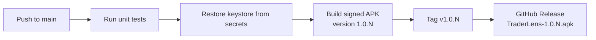

# Release pipeline

Every push to `main` produces a signed APK, a git tag and a GitHub Release. The workflow is [`.github/workflows/release.yml`](../.github/workflows/release.yml).

## Flow



1. **Trigger:** a push to `main`. It can also be started by hand from the Actions tab (Release, Run workflow). A manual run on any other branch builds the APK but skips the tag and Release.
2. **Tests:** `./gradlew :sharedLogic:testAndroidHostTest` on Ubuntu with JDK 21. A failing test stops the run before anything is signed or published.
3. **Signing:** the keystore is decoded from secrets into the runner's temp folder and `keystore.properties` is written, so the same Gradle signing config is used as for local builds. Both files are deleted at the end of the job, even when a step fails.
4. **Build:** `./gradlew :androidApp:assembleRelease -PversionCode=N -PversionName=1.0.N`, where `N` is the workflow run number.
5. **Publish:** `gh release create v1.0.N` tags the built commit and creates the release "TraderLens 1.0.N" with `TraderLens-1.0.N.apk` attached and notes generated from the commits since the previous tag.

Only one release job runs at a time, so two quick pushes cannot race for the same tag.

## Versioning

| Field | Value | Example |
|---|---|---|
| `versionCode` | Workflow run number | `1` |
| `versionName` | `1.0.` + run number | `1.0.1` |
| Git tag | `v` + `versionName` | `v1.0.1` |
| Asset | `TraderLens-<versionName>.apk` | `TraderLens-1.0.1.apk` |

The run number only grows, so every release can be installed over the previous one. Local builds without the properties default to `versionCode 1` and `versionName 1.0`.

## Secrets

Set in the repository under Settings, Secrets and variables, Actions:

| Secret | Content |
|---|---|
| `RELEASE_KEYSTORE_BASE64` | The release keystore file, base64 encoded |
| `RELEASE_STORE_PASSWORD` | Keystore password |
| `RELEASE_KEY_ALIAS` | Key alias |
| `RELEASE_KEY_PASSWORD` | Key password |

To set or rotate them from a machine that has the keystore and `keystore.properties`:

```sh
base64 -i /path/to/release.jks | tr -d '\n' | gh secret set RELEASE_KEYSTORE_BASE64
grep '^storePassword=' keystore.properties | cut -d= -f2- | tr -d '\n' | gh secret set RELEASE_STORE_PASSWORD
grep '^keyAlias=' keystore.properties | cut -d= -f2- | tr -d '\n' | gh secret set RELEASE_KEY_ALIAS
grep '^keyPassword=' keystore.properties | cut -d= -f2- | tr -d '\n' | gh secret set RELEASE_KEY_PASSWORD
```

The keystore must stay the same for the life of the app. Keep a backup outside the repository: losing it means future builds cannot update installed copies.

## dist/

`dist/` holds exactly one file: the APK of the latest GitHub Release, under the same name as the release asset. CI does not commit to the repository, so after a release, refresh it with:

```sh
rm -f dist/*.apk
gh release download --pattern '*.apk' --dir dist
git add -A dist && git commit -m "chore: update dist to $(ls dist)"
```

`gh release download` without a tag takes the latest release.

## Checking a release

```sh
apksigner verify --print-certs dist/TraderLens-1.0.1.apk
aapt2 dump badging dist/TraderLens-1.0.1.apk | grep version
```

The signer must be `CN=TraderLens, O=TraderLens`, and the version must match the tag.

## Not included yet

* Firebase App Distribution for testers
* Upload to Google Play
* Slack notifications
* iOS tests in CI (they run locally with `./gradlew :sharedLogic:allTests` on macOS)
